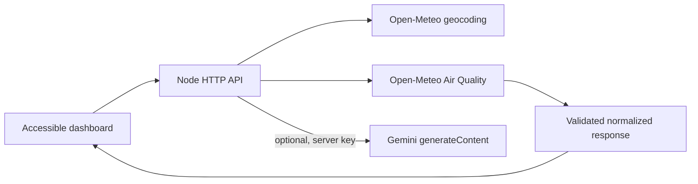

# AirWise AI
### Breathe Smarter. Live Healthier.

AirWise AI is an urban air quality assistant that helps people understand provider-reported pollutant concentrations, modelled indices and forecasts, and practical ways to reduce exposure.

## Problem and solution

Air data is difficult to interpret and index scales are often confused. AirWise makes location-based data easier to read, labels its source and status, keeps US and European AQI separate, and offers contextual guidance. It does not currently compute or display India's National AQI.

## Features

- Search locations using Open-Meteo geocoding or opt in to browser geolocation.
- Current PM2.5, PM10, NO₂, SO₂, CO and ozone when supplied.
- US AQI and European AQI explicitly identified and kept separate.
- Five-day modelled pollutant forecast chart, source timestamp and model status.
- Optional Gemini assistant grounded in selected location and available readings.
- General safety advice, pollutant explainers, mobile layout and keyboard focus states.
- API timeout, server-side caching, request validation and per-address rate limiting. Assistant requests use a compact context, at most six recent turns, and a 16 KiB JSON body limit.

## Architecture



## Stack

Node.js 20+ with native HTTP/fetch, HTML, CSS and browser ES modules. The visualization is native SVG; no chart dependency is required. Tests use Node's built-in test runner.

## Data sources and limitations

Open-Meteo Air Quality API supplies modelled pollutant concentrations and US/EU indices. The geocoding API supplies location matches. These values are not guaranteed to match a nearby monitor. AirWise does not currently connect to CPCB's official real-time dataset and does not claim an official partnership. CPCB National AQI requires appropriate pollutant averages and breakpoints; it is intentionally not inferred from Open-Meteo AQI scales. Forecasts are estimates, can change, and are not guarantees.

## GenAI integration

When `GEMINI_API_KEY` is set on the server, POST `/api/assistant` sends the user's question and selected normalized readings/forecast to Gemini's `generateContent` API. The prompt asks Gemini to ground current-condition statements in supplied values, identify missing data, avoid diagnosis, and provide concise general guidance. Responses are plain text rendered using `textContent`. Without a key, the server returns an explicit unavailable response; it does not pretend a fallback was generated.

## Security and privacy

Credentials remain in server environment variables. The app does not persist location history. Assistant requests are reduced to current readings and a small forecast summary, limited to six recent conversation messages, and capped at 16 KiB; each question is limited to 1,000 characters and history messages to 600. Other city/question inputs are validated, upstream requests have timeouts, response errors are generalized, and a simple in-memory per-IP rate limit is applied. There is no CORS allowance because the UI is served same-origin. No hosting-platform configuration exists in this repository. A host or reverse proxy may enforce a lower body limit before requests reach Node, so deployed limits should accommodate compact payloads (normally a few KiB) or provide a useful edge-level 413 response. A production deployment should use TLS and a shared rate-limit/cache store if horizontally scaled. Third party API responses can be delayed or unavailable.

## Accessibility

Semantic landmarks, labeled inputs, keyboard-operable controls, visible focus indicators, live status regions, chart summaries, non-color category text, and reduced-motion support are included. The interface adapts to narrow screens. A full assistive-technology audit has not been performed.

## Setup

Requirements: Node.js 20 or later.

```sh
cp .env.example .env
# optionally add GEMINI_API_KEY to .env; export it in your deployment environment
npm start
```

Open http://localhost:3000. The server does not load `.env` automatically; export variables in your shell or use your deployment platform's secret settings. On PowerShell: `$env:GEMINI_API_KEY="your-key"; npm start`.

### Environment variables

| Variable | Required | Use |
|---|---|---|
| `PORT` | No | HTTP port (default 3000) |
| `GEMINI_API_KEY` | No | Enables grounded Gemini answers; keep server-side |
| `GEMINI_MODEL` | No | Gemini model name (default `gemini-2.0-flash`) |
| `DATA_GOV_IN_API_KEY` | No | Reserved for a future verified CPCB/data.gov.in integration; currently unused |

## Demo mode

There are no hardcoded sample readings or demo data mode. The dashboard starts empty until a location is selected and a live provider response is received. If Gemini is not configured, assistant responses are marked unavailable.

## Tests and scripts

`npm test` runs deterministic unit tests against normalized fixture data. `npm run lint` performs JavaScript syntax checks. `npm run build` verifies required application artifacts. These scripts do not provide measured coverage, browser workflow automation, a full lint rule set, or an npm dependency audit. The project currently has no installed third-party npm dependencies; `npm audit` cannot evaluate runtime APIs or services.

## Deployment

Deploy on a Node.js 20+ host. Set `PORT` and optional `GEMINI_API_KEY`/`GEMINI_MODEL` as environment secrets, start with `npm start`, and expose the service over HTTPS through the platform's TLS endpoint. Configure health checks against `/api/health`. The in-memory cache and limiter are per process.

## Known limitations

- No official CPCB integration or Indian National AQI calculation is implemented.
- Open-Meteo endpoints require network availability.
- Gemini has not been exercised without a configured key and network connection in this workspace.
- Forecast activity-window ranking and historical yesterday comparison are not implemented because provider/historical data may be unavailable.
- Tests cover core normalization and guidance, not full browser workflows.

## Disclaimer

AirWise AI provides general environmental information and is not medical advice. Consult a qualified healthcare professional for personal medical concerns. Never use this application as an emergency monitor or as a substitute for certified indoor carbon monoxide alarms.
